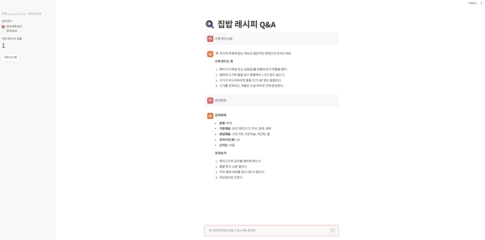
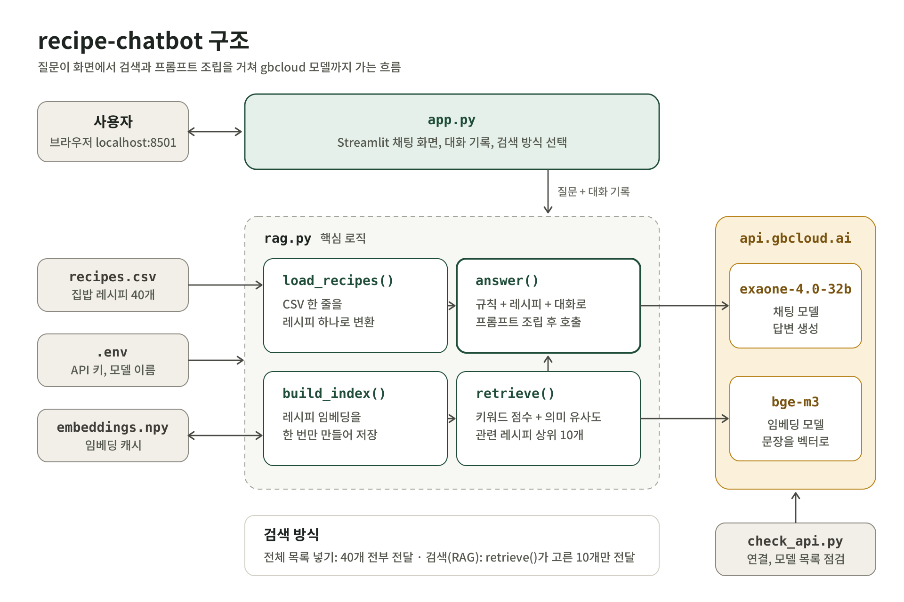

# 🍳 집밥 레시피 Q&A 챗봇

공공 AI 인프라인 GITC Open AI Service Hub(api.gbcloud.ai)의 무료 개발키로 만든 레시피 질의응답 챗봇입니다.
"김치찌개 어떻게 끓여?", "감자랑 양파로 뭐 만들 수 있어?", "15분 안에 되는 반찬 추천해줘" 같은 질문에 레시피 데이터를 근거로 답합니다.



## 구조



## 기술 스택
| 구분 | 사용 |
|---|---|
| 언어 | Python 3.11 |
| 화면 | Streamlit |
| 채팅 모델 | `exaone-4.0-32b` (LG AI연구원, 한국어 특화) |
| 임베딩 모델 | `bge-m3` (1024차원, 다국어) |
| API | OpenAI 호환 SDK (`openai` 라이브러리에 base_url만 변경) |

## 파일 구성
| 파일 | 역할 |
|---|---|
| `recipes.csv` | 예시 집밥 레시피 40개 (메뉴, 분류, 재료, 시간, 난이도, 조리순서) — 행을 추가하면 바로 반영 |
| `rag.py` | 데이터 로드 · 검색 · 프롬프트 조립 · LLM 호출 |
| `app.py` | Streamlit 채팅 화면 |
| `check_api.py` | 키·주소·모델명 확인용 연결 테스트 |
| `.env.example` | 설정 예시 (→ `.env`로 복사) |

## 실행 방법
```bash
conda create -n recipe-bot python=3.11 -y
conda activate recipe-bot
pip install -r requirements.txt
cp .env.example .env        # Windows: copy .env.example .env
python check_api.py         # ① 연결 확인 + 사용 가능한 모델 목록
streamlit run app.py        # ② 브라우저(localhost:8501)에서 채팅
```

`.env` 설정 항목
| 항목 | 설명 | 예시 |
|---|---|---|
| `GB_API_KEY` | gbcloud 개발키 | `sk-dev-...` |
| `GB_BASE_URL` | API 주소 | `https://api.gbcloud.ai/v1` |
| `CHAT_MODEL` | 답변 생성 모델 | `exaone-4.0-32b` |
| `EMBED_MODEL` | 임베딩 모델 (비우면 키워드 검색만) | `bge-m3` |

## 두 가지 검색 방식
- **전체 목록 넣기**: 레시피 40개를 통째로 프롬프트에 넣음. 데이터가 작을 때 가장 정확.
- **검색(RAG)**: 키워드 점수와 임베딩 유사도로 관련 레시피 10개만 골라서 넣음. 답변 아래 "참고한 레시피"로 근거 확인 가능.
  레시피가 수백 개 이상으로 늘어나면 이 방식이 필요해집니다.

## 설계하면서 고민한 점
- **지어낸 답변(환각) 막기**: 시스템 프롬프트에 "레시피 목록에 있는 정보로만 답하고, 없는 메뉴는 없다고 말할 것"이라는 규칙을 넣어, 목록에 없는 메뉴를 물으면 꾸며내지 않고 안내하도록 했습니다.
- **답변 근거 보여주기**: RAG 모드에서 검색된 레시피를 함께 표시해, 답이 틀렸을 때 검색 문제인지 모델 문제인지 구분할 수 있게 했습니다.
- **무료 한도 안에서 운영**: 개발키는 하루 500건·분당 10회 제한이 있어서, 레시피 임베딩은 처음 한 번만 만들어 파일(`embeddings.npy`)로 저장하고 대화 기록은 최근 6개만 보내 토큰을 아꼈습니다.
- **화면과 로직 분리**: 화면(`app.py`)과 로직(`rag.py`)을 나눠, 나중에 화면을 웹 API나 메신저 봇으로 바꿔도 로직은 그대로 쓸 수 있게 했습니다.

## 트러블슈팅
| 증상 | 원인 | 해결 |
|---|---|---|
| `Error code: 503` | 해당 모델 서버가 일시적으로 바쁨 (llama-3.3-70b에서 발생) | 다른 모델(`exaone-4.0-32b`)로 변경 |
| `No such file: requirements.txt` | 압축 해제 시 폴더가 이중으로 생성됨 | `dir`로 확인 후 안쪽 폴더로 이동 |
| 테스트 답변이 엉뚱함 | 시스템 프롬프트 없이 기본 temperature로 호출 | 역할·규칙을 주는 system 메시지와 `temperature=0.3` 적용 |